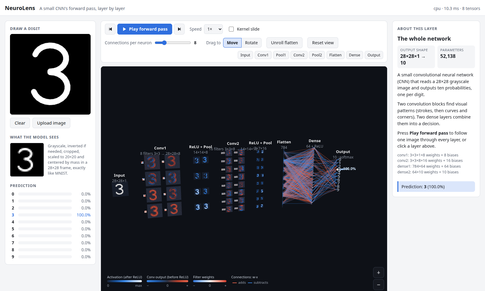
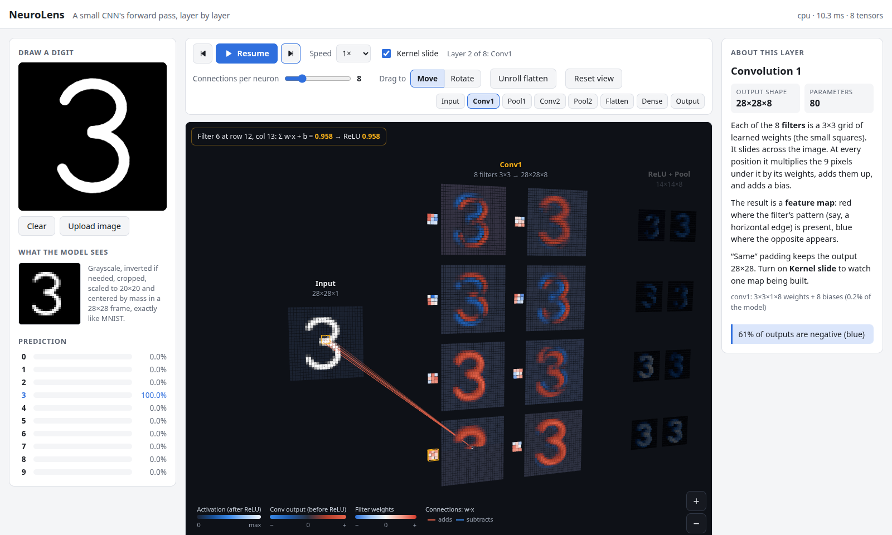
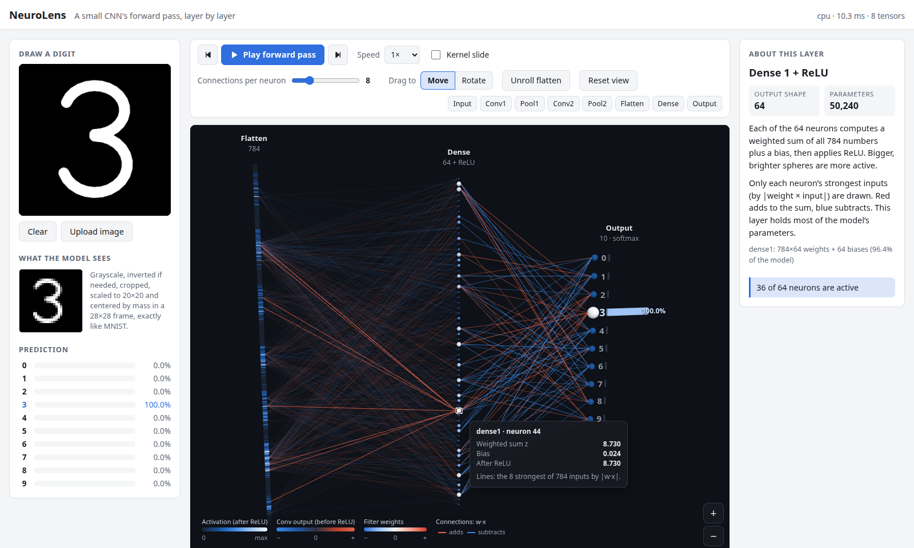
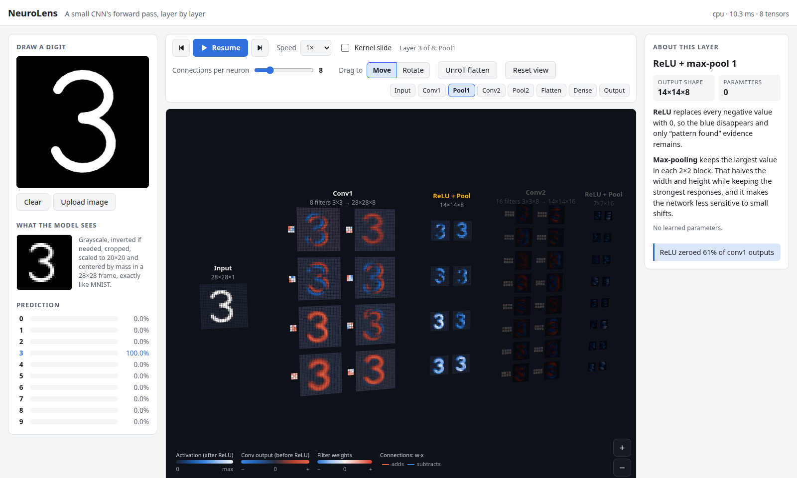
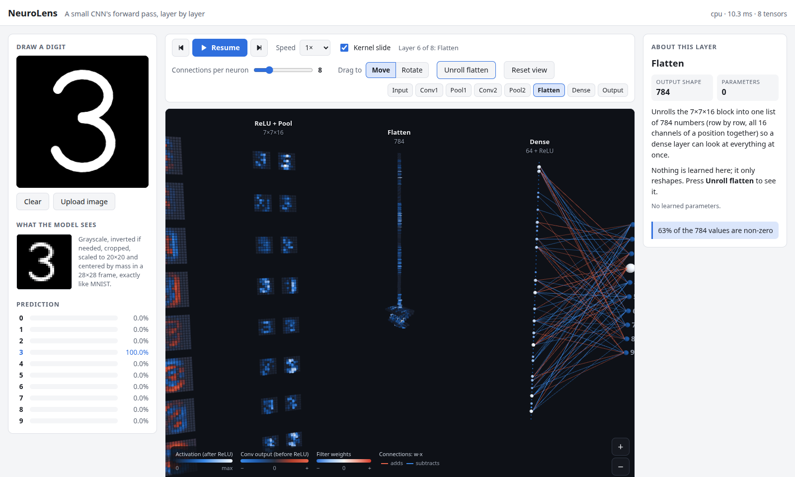
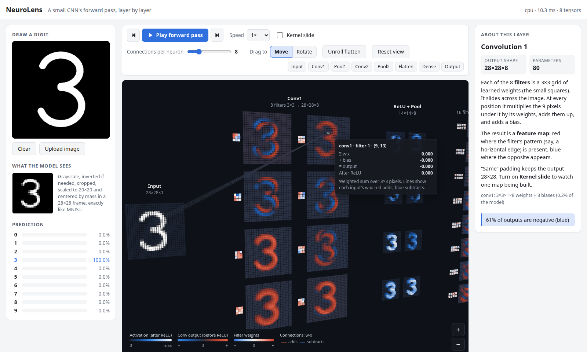
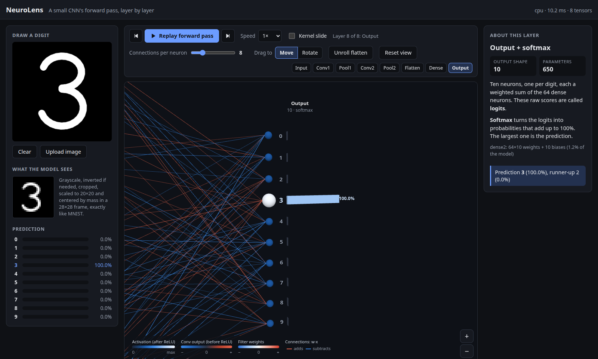
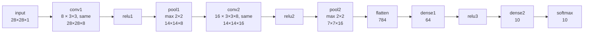
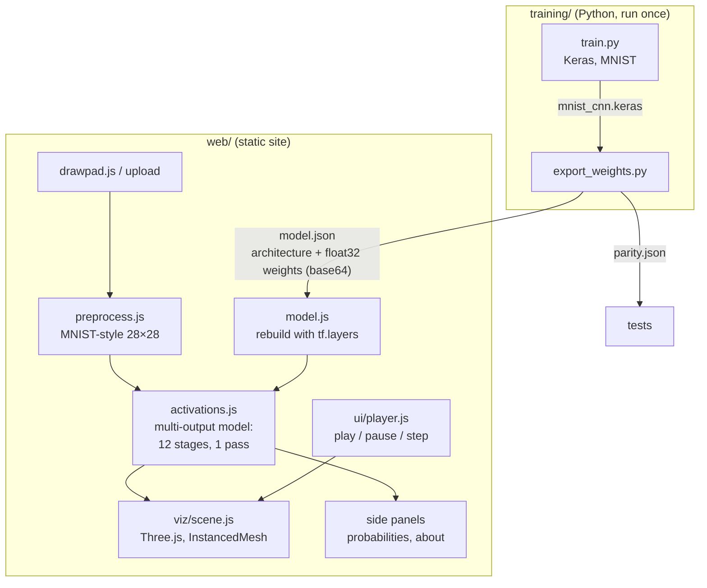
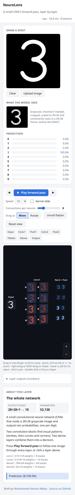

# NeuroLens

By **Muhammad Haroon Abbas** ([@RealHaroon](https://github.com/RealHaroon))

Draw a digit and watch a small convolutional neural network classify it, layer by layer, in an
interactive 3D scene. Every step of the forward pass is visible: input pixels, convolution
kernels, feature maps, ReLU, max-pooling, flatten, dense neurons with their strongest weighted
connections, and the softmax output.

Everything runs in the browser (TensorFlow.js + Three.js) as a static site with no backend. It is
built to be light enough for an 8 GB laptop with integrated graphics.



## Features

- **Draw or upload** a digit. Uploads go through MNIST-style preprocessing (grayscale, auto-invert,
  crop, fit into 20×20, center by mass in 28×28), and the exact 28×28 image the model sees is shown.
- **Live predictions** as you draw (about 10 ms per update, inference on the CPU backend).
- **3D forward pass**: one station per stage, left to right. Cells extrude by |activation|.
- **Top-k connections** for every dense neuron, ranked by |weight × input| (k slider, default 8),
  colored by sign and with opacity by magnitude.
- **Navigation like a map or design tool**: drag (or one finger) slides the view; two-finger
  trackpad scroll slides; pinch (trackpad or touchscreen), Ctrl+scroll, a mouse wheel, the on-screen
  +/− buttons or the +/− keys zoom toward the cursor; right-drag, Shift+drag or the **Rotate** drag
  mode tilts the scene.
- **Hover / click any cell or neuron** for its exact value and incoming connections: conv receptive
  field with Σ w·x + bias, the pool window with the winning cell, the flatten source, dense top-k.
- **Play forward pass**: the camera flies station to station while layers light up in order.
  Pause, step back/forward (← / →, Space), speed 0.5×–4×.
- **Kernel slide** (toggle): watch one 3×3 filter sweep the input and build its feature map
  cell by cell.
- **Flatten unroll**: the 7×7×16 block animates into the 784-cell column.
- **About this layer** panel: a plain-English explanation, output shape, parameter count, and a
  live fact about the current input.
- Responsive (desktop, tablet, phone) and follows the system light/dark theme.

| Kernel slide | Dense layer top-k on hover |
|---|---|
|  |  |
| **Playback: layers light up in order** | **Flatten unroll** |
|  |  |
| **Conv receptive field on hover** | **Dark theme** |
|  |  |

## Model

Small enough that every activation can be drawn. Activations are separate layers so pre- and
post-ReLU values can both be read.



| Layer | Output | Parameters |
|---|---|---|
| conv1 (3×3×1×8 + 8) | 28×28×8 | 80 |
| relu1 → pool1 | 14×14×8 | 0 |
| conv2 (3×3×8×16 + 16) | 14×14×16 | 1,168 |
| relu2 → pool2 | 7×7×16 | 0 |
| flatten | 784 | 0 |
| dense1 (784×64 + 64) → relu3 | 64 | 50,240 |
| dense2 (64×10 + 10) → softmax | 10 | 650 |
| **Total** | | **52,138** |

5 epochs on MNIST with Adam: **98.45% test accuracy** (about 40 s on a laptop CPU).

## App architecture



## Setup

Requirements: **Python 3.12** (TensorFlow has no stable wheel for 3.13+ yet), **Node.js ≥ 20.19**
(or ≥ 22.12), and any modern browser. No GPU needed.

### 1. Train and export (optional: the exported model is committed)

```bash
cd training
python3.12 -m venv .venv            # or: uv venv -p 3.12 .venv
.venv/bin/pip install -r requirements.txt
.venv/bin/python train.py           # ~40 s on CPU, prints test accuracy
.venv/bin/python export_weights.py  # -> web/public/model/model.json (+ test fixture)
```

The official `tensorflowjs` converter is not used. The only version that installs next to
TF 2.21 is 3.18.0, which predates Keras 3. `export_weights.py` instead writes the architecture and
every weight tensor (float32, base64) to JSON, and `web/src/model.js` rebuilds the identical model
with `tf.layers`. `npm run test:parity` confirms it matches Python at every layer.

### 2. Run the web app

```bash
cd web
npm install
npm run dev       # http://localhost:5173
npm run build     # static production build in web/dist
npm run preview   # serve the production build locally
```

### Tests

```bash
npm run test:parity    # TF.js vs Python: predictions + every intermediate activation
npm run test:pipeline  # activation probe, tensor-leak check, preprocessing robustness
npm run test:scene     # 3D data mapping: layout coverage, receptive fields, top-k
npm run test:e2e       # production build in headless Chrome: draw, upload, 3D, playback
npm test               # all of the above
npm run screenshots    # regenerate docs/screenshots/
```

The browser tests use your installed Chrome (`/usr/bin/google-chrome`, override with
`CHROME_PATH`) and the real GPU when there is one.

> **Paths containing `:`** (e.g. `/run/media/…/Local Disk (D:)/…`) break two tools, and both are
> handled. npm's `PATH`-based lookup of `node_modules/.bin` fails, so the scripts call
> `node node_modules/vite/bin/vite.js` directly. Vite's dev-server allow-list rejects every file
> (403), so `vite.config.js` turns off `server.fs.strict` only when the path contains `:`.

## Deployment

The build in `web/dist` is a plain static site with relative asset paths, so it works at a domain
root or under a sub-path.

- **Netlify**: `netlify.toml` is included (base `web`, command `npm run build`, publish `dist`).
  Connect the repository and deploy.
- **GitHub Pages**: run `npm run build` and publish the contents of `web/dist` (for example to a
  `gh-pages` branch, or with the `actions/upload-pages-artifact` + `actions/deploy-pages` workflow).

## Performance notes

- **Inference**: TF.js CPU backend. The model is tiny (a full pass with preprocessing takes about
  10 ms), activations are read back for free, and the GPU stays free for rendering. Only
  `tfjs-core`, `tfjs-layers` and `tfjs-backend-cpu` are bundled. All tensors are disposed after
  each pass, and the tests check the tensor count stays constant.
- **Rendering**: one `InstancedMesh` per layer (14 draw calls for the whole network). A new input
  only rewrites the instance color/matrix arrays. Picking is a ray–plane intersection instead of a
  raycast over about 15k instances. Frames render only when something changes. Orbiting holds
  **60 fps on Intel UHD integrated graphics**.
- **Bundle**: about 140 kB gzipped for the app + TF.js. Three.js (about 150 kB gzipped) loads
  lazily, so drawing and predictions work before the 3D view arrives.

## Project structure

```
training/
  train.py              build + train the CNN, print test accuracy
  export_weights.py     write web/public/model/model.json and the parity fixture
  requirements.txt
web/
  index.html
  public/model/model.json
  src/
    main.js             UI wiring: input, predictions, toolbar, about panel
    model.js            rebuild the Keras model in TF.js and load weights
    activations.js      one forward pass -> all 12 stages + weights
    preprocess.js       MNIST-style preprocessing
    drawpad.js          280×280 pointer drawing canvas
    tf.js               the TF.js subset the app uses
    viz/                Three.js scene: layout, colormaps, instanced primitives, connections
    ui/                 forward-pass player, layer explanations
  test/                 parity, pipeline, scene logic, e2e, screenshots
docs/screenshots/
```

| Phone layout | |
|---|---|
|  | On narrow screens the panels stack and the 3D view opens on the first layers. Orbit, pinch-zoom and the layer buttons reach the rest; tap a cell to pin its tooltip. |

## Author

**Muhammad Haroon Abbas** · [github.com/RealHaroon](https://github.com/RealHaroon)
